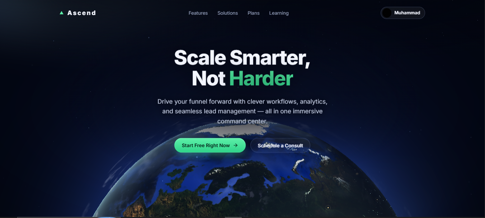
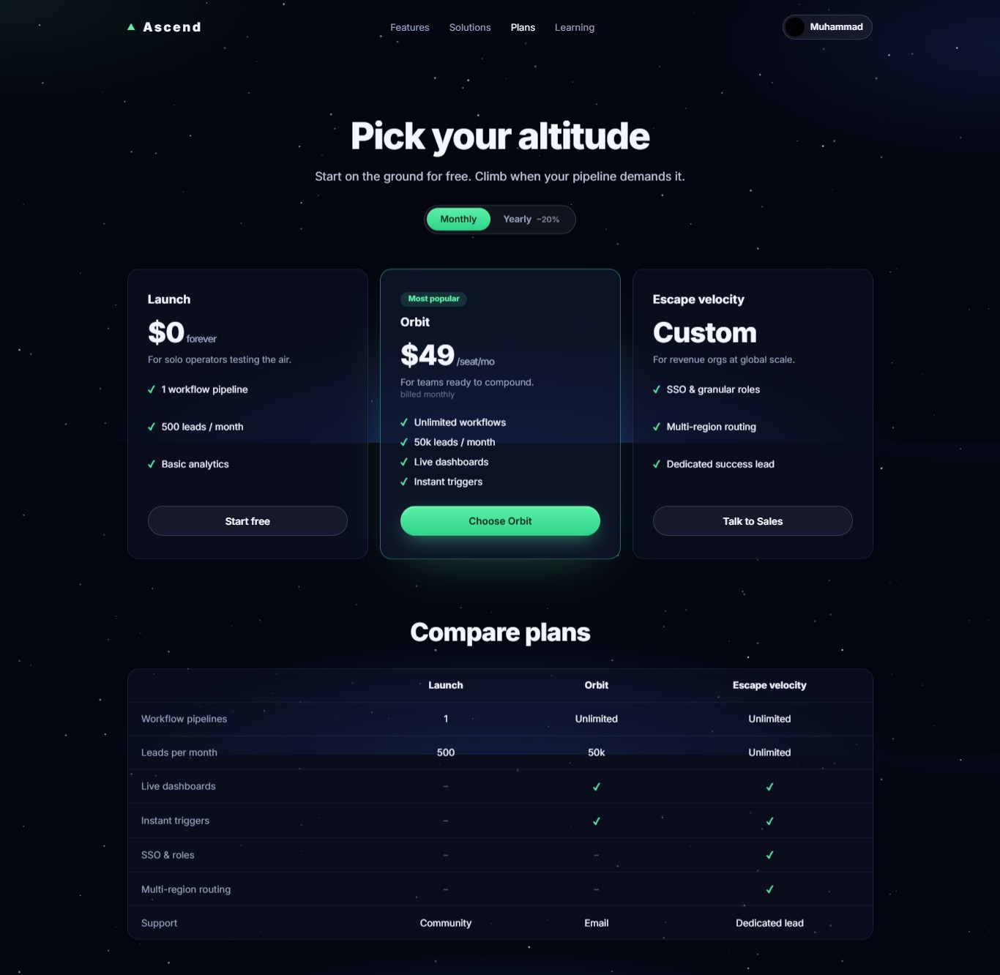
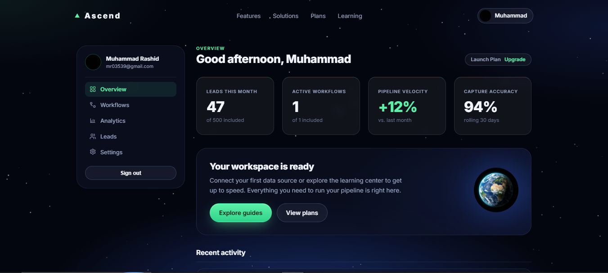

# ▲ Ascend — Revenue Command Center

<p align="center">
  
  
  
  
  
  
</p>

<p align="center">
  A fully handcrafted, <strong>zero-dependency SaaS landing page</strong> with a live 3D planet, real Firebase authentication (Google & GitHub OAuth), and a protected user dashboard — built to showcase modern front-end engineering and UX/UI skills.
</p>

<p align="center">
  <a href="https://github.com/MohdRashid1607/Ascend"><strong>View Repo</strong></a> ·
  <a href="https://github.com/MohdRashid1607/Ascend/issues">Report Bug</a> ·
  <a href="https://github.com/MohdRashid1607/Ascend/issues">Request Feature</a>
</p>

---

## Live Demo

> **[Live on Vercel →](https://ascend-mohdrashid.vercel.app)** *(update this link after deploying)*

---

## Screenshots

### Home — 3D Globe Hero


### Pricing


### User Dashboard


---

## Features

| Feature | Details |
|---|---|
| **Live 3D planet** | Real-time WebGL globe rendered with Three.js and custom GLSL shaders |
| **Real authentication** | Google & GitHub OAuth via Firebase Auth — users are persisted, no backend required |
| **Auth-aware nav** | Sign Up button swaps to user avatar + name on login, reverts on sign-out |
| **User dashboard** | Protected route — Overview, Workflows, Analytics, Leads, Settings panels |
| **Email/password auth** | Create account + login with password-strength meter and field validation |
| **Scroll animations** | Intersection Observer-powered reveal animations with staggered delays |
| **Glassmorphism UI** | Dark mode, backdrop blur, radial gradients, animated starfield background |
| **Fully responsive** | Mobile-first layout — nav collapses, grid reflows, sidebar stacks |
| **Zero build step** | Pure ES modules via CDN — open `index.html` and it works |
| **Learning center** | Filterable, searchable guide library with individual guide pages |
| **Pricing page** | Monthly/yearly toggle with 3 tiers and comparison table |
| **Smooth scroll** | Lenis smooth-scroll for buttery-smooth page traversal |

---

## Tech Stack

```
HTML5 + Vanilla CSS + Vanilla JS (ES Modules)
Three.js   — 3D planet & GLSL shaders
Firebase   — Google OAuth, GitHub OAuth, Email/Password Auth
Lenis      — Smooth scroll
Inter      — Google Fonts typography
Vercel     — Static hosting
```

No React. No Tailwind. No build step. Just clean, modern web fundamentals.

---

## Project Structure

```
Ascend/
├── index.html          — Landing page (3D globe, hero, features, plans)
├── account.html        — Login / Sign up
├── dashboard.html      — Protected user dashboard
├── plans.html          — Pricing page
├── learning.html       — Filterable guide library
├── guide.html          — Individual guide reader
├── contact.html        — Contact / sales form
├── privacy.html        — Privacy policy
├── terms.html          — Terms of service
├── 404.html            — Custom 404 page
│
├── img/
│   ├── planet.png              — Photorealistic Earth used on auth & dashboard pages
│   ├── screenshot_home.png     — Home page preview
│   ├── screenshot_plans.png    — Pricing page preview
│   └── screenshot_dashboard.png — Dashboard preview
│
├── css/
│   ├── base.css        — Design tokens, buttons, nav avatar styles
│   ├── sections.css    — Page sections (hero, features, showcase, CTA)
│   ├── Components.css  — Shared UI (dialog, marquee, nav)
│   ├── Pages.css       — Inner page styles (plans, learning, contact, auth)
│   └── dashboard.css   — Dashboard layout, panels, table, toggles
│
└── js/
    ├── firebase.js     — Firebase App + Auth helpers (Google, GitHub, email)
    ├── layout.js       — Shared nav injection + auth-aware avatar swap
    ├── main.js         — Homepage orchestration (3D scene, features, plans)
    ├── scene.js        — Three.js planet renderer
    ├── Shaders.js      — Custom GLSL vertex + fragment shaders
    ├── account.js      — Auth logic (sign in, sign up, OAuth)
    ├── dashboard.js    — Dashboard hydration, auth guard, panel switching
    ├── ui.js           — Mobile nav toggle, smooth anchor links
    ├── pages.js        — Scroll-reveal IntersectionObserver for inner pages
    ├── plans.js        — Billing toggle (monthly / yearly)
    ├── learning.js     — Guide grid, category filter, search
    ├── guides.js       — Guide data
    ├── guide.js        — Individual guide renderer
    ├── contact.js      — Contact form validation + submission
    └── data.js         — Feature icons, stats, plan data
```

---

## Firebase Setup (5 minutes)

> You need a free Firebase account to enable Google/GitHub sign-in.

### 1. Create a Firebase project

1. Go to [console.firebase.google.com](https://console.firebase.google.com)
2. Click **"Add project"** → name it `Ascend`
3. Click the **`</>`** (Web) icon → register the app → copy the `firebaseConfig` object

### 2. Enable Authentication

1. **Authentication → Get started → Sign-in method**
2. Enable **Google** — toggle on + pick a support email
3. Enable **GitHub**:
   - Go to [github.com/settings/developers](https://github.com/settings/developers) → **New OAuth App**
   - **Callback URL**: copy from the Firebase GitHub sign-in panel
   - Paste the **Client ID** and **Client Secret** into Firebase → **Save**

### 3. Paste your config into `js/firebase.js`

Replace the placeholder values with your real Firebase project values.

### 4. Add your domains to Firebase

**Authentication → Settings → Authorized domains** → Add:
- `localhost`
- Your Vercel domain e.g. `ascend-yourname.vercel.app`

---

## Deploy to Vercel

```bash
# Push to GitHub first
git init
git add .
git commit -m "feat: Ascend SaaS landing page with Firebase auth"
git branch -M main
git remote add origin https://github.com/MohdRashid1607/Ascend.git
git push -u origin main
```

Then:
1. Go to [vercel.com](https://vercel.com) → **Sign in with GitHub**
2. Click **"Add New Project"** → import the `Ascend` repo
3. Leave all settings as default (no build command needed — it's a static site)
4. Click **"Deploy"** — live in ~20 seconds

---

## Run Locally

```bash
# Python
python3 -m http.server 8000

# Node.js
npx serve .

# VS Code — right-click index.html → Open with Live Server
```

> You must serve over HTTP (not `file://`) for ES modules and Firebase to work.

---

## Pages

| Page | Route | Description |
|---|---|---|
| Home | `/index.html` | 3D globe hero, features, showcase, pricing teaser, CTA |
| Sign up / Log in | `/account.html` | Google, GitHub, or email authentication |
| Dashboard | `/dashboard.html` | Protected — requires sign-in |
| Pricing | `/plans.html` | Monthly/yearly toggle, 3 tiers, comparison table, FAQ |
| Learning | `/learning.html` | Searchable, filterable guide library |
| Guide | `/guide.html?id=...` | Individual guide reader |
| Contact | `/contact.html` | Sales / support contact form |
| Privacy | `/privacy.html` | Privacy policy |
| Terms | `/terms.html` | Terms of service |
| 404 | `/404.html` | Custom not-found page |

---

## Design System

| Token | Value | Usage |
|---|---|---|
| `--bg` | `#04060f` | Page background |
| `--accent` | `#5df0a8` | Green brand colour |
| `--accent-2` | `#2fd38a` | Gradient end |
| `--ink` | `#f3f6ff` | Primary text |
| `--muted` | `#9aa6c4` | Secondary text |
| `--glass` | `rgba(12,18,38,.55)` | Card backgrounds |
| `--radius-lg` | `26px` | Card border radius |
| `--font` | `'Inter'` | Body & headings |

---

## Author

**Mohd Rashid**
- GitHub: [@MohdRashid1607](https://github.com/MohdRashid1607)
- Repo: [github.com/MohdRashid1607/Ascend](https://github.com/MohdRashid1607/Ascend)

---

## License

MIT — free to use, fork, and adapt. Attribution appreciated but not required.

---

<p align="center">Built with care by a front-end developer who believes the web should be beautiful.</p>
